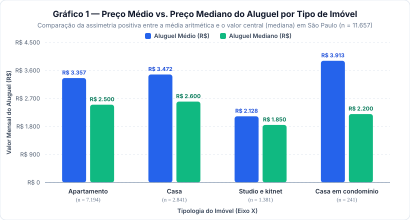
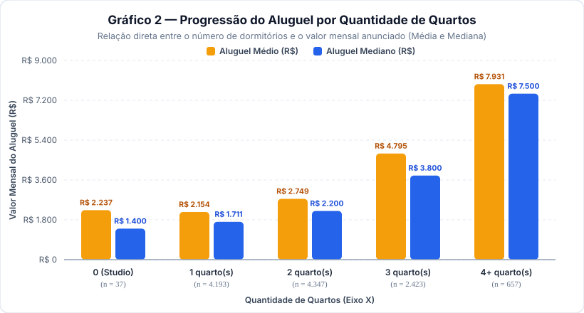
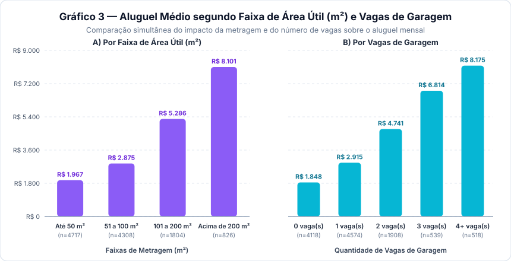
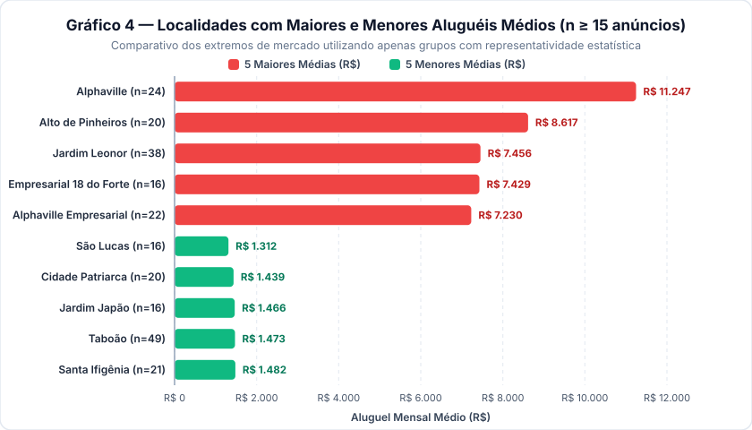
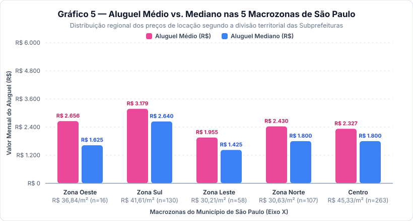

# 🏙️ São Paulo Housing Analytics — Desafio SYNAPTA 2026

> **Análise Exploratória, Geoespacial e Aplicação Web em Flask sobre os Preços de Aluguel na Cidade de São Paulo**  
> **Processo Seletivo SYNAPTA — Laboratório de Dados e Inteligência Artificial | Edital nº 1/2026 — UNINASSAU Maceió**

---

## 👤 1. Identificação do Candidato e do Projeto

| Campo | Informação |
| :--- | :--- |
| **Candidato** | **Guilherme Domingos dos Santos** *(Candidato nº 11 — Edital nº 1/2026)* |
| **Instituição** | Centro Universitário Maurício de Nassau — **UNINASSAU Maceió** |
| **Curso** | Ciência da Computação |
| **Opção Escolhida** | **Opção 1 — Análise de preços de aluguel em São Paulo (*Sao Paulo Housing Prices*)** |
| **Formato da Entrega** | Pipeline de Dados em Python + Servidor Web Local em **Flask** (API REST + Dashboard Interativo Leaflet/Chart.js) + Relatório Técnico Reprodutível |

---

## ⚡ Guia Rápido: 4 Formas de Executar ou Visualizar Este Projeto

Para garantir **100% de reprodutibilidade em qualquer computador (Windows, Linux, macOS ou na Nuvem)** e evitar qualquer erro de ambiente na avaliação, este projeto foi arquitetado para funcionar de **4 maneiras independentes**:

> ### 🟡 Modo 1 — Execução em Nuvem no Google Colab (Zero Instalação Local)
> Execute toda a análise estatística, auditoria de qualidade, gráficos interativos com Plotly e mapa interativo com Folium diretamente no navegador:  
> [](https://colab.research.google.com/github/gui-santos-dev/synapta/blob/main/Sao_Paulo_Housing_Analytics.ipynb)  
> Basta clicar no botão acima ou abrir o arquivo [`Sao_Paulo_Housing_Analytics.ipynb`](Sao_Paulo_Housing_Analytics.ipynb) no Google Colab e clicar em **Ambiente de Execução > Executar tudo**.
>
> ---
> ### 🟢 Modo 2 — Completo Local (Servidor Flask + API REST + Dashboard)
> No terminal, dentro da pasta do projeto, instale as dependências e inicie o servidor:
> ```bash
> pip install -r requirements.txt
> python app.py
> ```
> *(💡 **Dica para Windows:** Caso o comando `python` não esteja no PATH e abra a Microsoft Store, utilize o Python Launcher nativo do Windows: **`py -m pip install -r requirements.txt`** e **`py app.py`**).*  
> 👉 Em seguida, acesse no navegador: **[http://127.0.0.1:5000](http://127.0.0.1:5000)** *(se a porta `5000` estiver em uso, o servidor escolhe automaticamente a próxima porta livre, como `5001`, e exibe o link no terminal)*.
>
> ---
> ### 🔵 Modo 3 — Direto no Navegador (Sem Instalar Nada / Zero Configuração)
> Caso não deseje instalar bibliotecas Python ou usar o terminal:
> - Basta abrir a pasta [`web/`](web/) e dar **duplo clique no arquivo [`web/index.html`](web/index.html)** para abri-lo diretamente em qualquer navegador (Chrome, Edge, Firefox, Safari).
> - O script [`web/js/app.js`](web/js/app.js) detecta automaticamente o protocolo local (`file://`) e carrega a base pré-processada ([`web/data/housing_data.js`](web/data/housing_data.js) e [`web/data/sp_zones.js`](web/data/sp_zones.js)), mantendo **100% do mapa interativo, filtros por zona, gráficos e listagem de anúncios funcionando offline/sem servidor**.
>
> ---
> ### 🟣 Modo 4 — Leitura Direta no Próprio GitHub
> - Este arquivo **`README.md`** já contém o **relatório técnico completo**, o dicionário de variáveis, a auditoria de qualidade, as tabelas estatísticas, as conclusões e os **5 gráficos vetoriais (`graficos/*.svg`) renderizados nativamente** na página inicial do GitHub, permitindo avaliar toda a análise imediatamente sem precisar baixar os arquivos.

---

## 🎯 2. Objetivo e Pergunta Orientadora

Este projeto investiga o comportamento dos preços de locação residencial em São Paulo a partir de **11.657 anúncios imobiliários**, buscando compreender como atributos físicos (**área útil**, **quantidade de quartos**, **vagas de garagem** e **tipologia do imóvel**) e o fator locacional (**bairro/distrito** e **Macrozona da cidade**) se relacionam com o valor mensal anunciado.

### Pergunta Orientadora do Desafio (Anexo I — Opção 1)
> *"Quais características parecem acompanhar os maiores e os menores preços de aluguel e o que os dados não permitem concluir?"*

---

## 🛠️ 3. Documentação Completa das Tecnologias Utilizadas (Linguagens, Frameworks, Dados e IA)

Abaixo está o inventário completo de todas as tecnologias empregadas na construção do projeto, desde as linguagens de programação de backend e frontend até os modelos de Inteligência Artificial Generativa utilizados como suporte de desenvolvimento.

### 3.1. Linguagens de Programação, Marcação, Estilo e Dados

| Linguagem / Formato | Camada | Papel e Aplicação no Projeto |
| :--- | :--- | :--- |
| **Python 3 (`3.10+` / `3.14`)** | Backend, ETL & Ciência de Dados | Linguagem central do projeto. Utilizada no servidor web local (`app.py`), no pipeline de limpeza, cálculo estatístico e indexação geoespacial *Ray-Casting* (`processar_dados.py`) e na geração automatizada dos gráficos vetoriais (`gerar_graficos.py`). |
| **JavaScript (`ES6+` / Vanilla JS)** | Frontend & Interatividade | Arquitetura modular (`app.js`, `map.js`, `ui.js`) responsável pelo consumo assíncrono da API Flask (`fetch('/api/dados')`), renderização dinâmica dos gráficos e mapas, filtros combinados em tempo real (Região + Bairro + Tipologia + Faixa de Preço) e alternância de tema claro/escuro. |
| **HTML5 Semântico** | Estrutura de Interface | Construção da interface analítica em tela dividida (*Split-View Workspace*: Mapa Interativo à esquerda e Painel de Indicadores/Tabelas/Diagnóstico à direita), com atributos de acessibilidade (`role`, `aria-label`, `aria-live`). |
| **CSS3 Moderno** | Estilização & Responsividade | Arquitetura de estilos modularizada (`variables.css`, `layout.css`, `components.css`) utilizando *CSS Custom Properties* (Design Tokens para *Light Mode* e *Dark Mode*), *CSS Grid*, *Flexbox*, divisor redimensionável e *Container Queries* (`@container`). |
| **JSON & GeoJSON** | Intercâmbio & Geoprocessamento | Formato estruturado da API REST (`/api/*`), armazenamento das estatísticas consolidadas (`housing_data.json`) e representação dos polígonos territoriais das 32 Subprefeituras e 96 Distritos de São Paulo (`sp_zones.js`). |
| **CSV (*Comma-Separated Values*)** | Fonte de Dados Bruta | Estrutura tabular original do dataset público do Kaggle (`data.csv` com 11.657 linhas e 8 colunas). |
| **SVG (*Scalable Vector Graphics*)** | Visualização Estática | Gráficos vetoriais de alta definição gerados via Python (`graficos/*.svg`) para exibição nativa neste `README.md` no GitHub. |

### 3.2. Frameworks, Bibliotecas e Serviços Cartográficos

| Tecnologia | Versão | Finalidade Técnica |
| :--- | :--- | :--- |
| **Flask** | `3.1.3` | Microframework web em Python utilizado para servir a aplicação localmente (`http://127.0.0.1:5000`) e expor os endpoints da API REST (`/api/status`, `/api/dados`, `/api/regioes`, `/api/bairros`, `/api/rankings`, `/api/reprocessar`). |
| **Werkzeug & Jinja2** | `3.1.x` | Motor WSGI HTTP e engine de templates subjacentes ao ecossistema Flask. |
| **Biblioteca Padrão Python** | Nativa | Módulos `csv` (leitura tabular), `statistics` (cálculo exato de média e mediana), `unicodedata` (normalização textual de bairros sem acentos), `collections` (`defaultdict`, `Counter`), `json` e `os`. |
| **Leaflet.js** | `1.9.4` | Biblioteca JavaScript open-source para mapas interativos, renderizando a malha GeoJSON das 5 Macrozonas de São Paulo e os círculos proporcionais georreferenciados por bairro. |
| **Chart.js** | `4.4.4` | Biblioteca de visualização gráfica em `<canvas>` HTML5 para atualização dinâmica dos gráficos conforme o usuário filtra regiões ou bairros no painel. |
| **OpenStreetMap & Esri ArcGIS** | Tiles Abertos | Provedores gratuitos de camadas cartográficas (Mapa de Ruas OSM, Modo Noturno Esri Dark Gray, Vias Claras e Imagens de Satélite Esri World Imagery). |

### 3.3. Linguagem de IA, Modelos Generativos (LLMs) e Declaração de Uso Responsável

Em estrito cumprimento ao **Item 3 (Orientações Gerais)** e ao **Item 4 (Entrega Obrigatória pelo GitHub)** do **Edital nº 1/2026 da SYNAPTA**, declara-se de forma transparente o uso de Inteligência Artificial Generativa no desenvolvimento deste projeto:

| Dimensão da IA | Especificação Técnica |
| :--- | :--- |
| **Ambiente / Plataforma Agêntica** | **Google Antigravity IDE** (Ambiente de desenvolvimento assistido por agentes da equipe *Google DeepMind*). |
| **Modelos de Linguagem (LLMs)** | Família **Google Gemini** (**Gemini 4 Argon** e **Gemini 3.8 Flash**) — Modelos Fundacionais baseados na arquitetura **Transformer Multimodal** com raciocínio em cadeia (*Chain-of-Thought*) e síntese de código. |
| **Paradigma de Interação** | Engenharia de Prompts estruturada em **Português (`pt-BR`)** voltada a *Pair Programming* (programação em par), estruturação de código Flask/JS e organização documental. |
| **Finalidade do Uso** | 1. Estruturação da interface web responsiva (HTML/CSS/JS) e integração do servidor **Flask**.<br>2. Apoio na implementação do algoritmo geométrico *Point-in-Polygon (Ray-Casting)* para classificar os bairros do CSV nas 5 regiões geográficas de São Paulo.<br>3. Padronização visual dos gráficos SVG e organização da documentação técnica no `README.md`. |
| **Como os Resultados Foram Verificados pelo Candidato** | **Auditoria determinística em 100% dos números e métricas:**<br>1. Todos os valores estatísticos (média de `R$ 3.250,81`, mediana de `R$ 2.415,00`, total de `11.657` linhas, `2` registros com área zero e `46` duplicatas parciais) foram calculados diretamente pelo script determinístico `processar_dados.py` sobre o arquivo `data.csv` original usando o módulo `statistics` do Python.<br>2. As classificações geográficas dos bairros (Zona Oeste, Zona Sul, Zona Leste, Zona Norte, Centro e Região Metropolitana) foram inspecionadas e conferidas manualmente no mapa interativo e na tabela de bairros.<br>3. Os rankings de localidades foram auditados para garantir o filtro mínimo de representatividade (`n >= 15` anúncios), evitando distorções causadas pelos 340 bairros que possuem apenas 1 imóvel anunciado. |

---

## 📂 4. Fonte dos Dados e Descrição das Colunas

- **Dataset Público no Kaggle**: [Sao Paulo Housing Prices](https://www.kaggle.com/datasets/renatosn/sao-paulo-housing-prices)
- **Arquivo Principal**: `data.csv`
- **Volume Total**: **11.657 linhas** (anúncios de imóveis) e **8 colunas** originais.

### Dicionário de Variáveis (Colunas Originais e Derivadas)

| Coluna | Tipo | Origem | Descrição (com as próprias palavras) |
| :--- | :--- | :--- | :--- |
| `address` | Texto (`string`) | Original (`data.csv`) | Logradouro (rua, avenida ou alameda) onde o imóvel para locação está localizado. |
| `district` | Texto (`string`) | Original (`data.csv`) | Nome do bairro ou distrito informado no anúncio (ex.: *Pinheiros*, *Vila Mariana*, *Mooca*, *Santana*). |
| `area` | Numérico (`float`) | Original (`data.csv`) | Área útil ou construída do imóvel, medida em **metros quadrados ($\text{m}^2$)**. |
| `bedrooms` | Inteiro (`int`) | Original (`data.csv`) | Quantidade total de quartos (dormitórios) do imóvel. |
| `garage` | Inteiro (`int`) | Original (`data.csv`) | Número de vagas de estacionamento/garagem disponíveis para o locatário. |
| `type` | Texto (`string`) | Original (`data.csv`) | Categoria ou tipologia do imóvel, dividida em 4 classes: `Apartamento`, `Casa`, `Studio e kitnet` e `Casa em condomínio`. |
| `rent` | Numérico (`float`) | Original (`data.csv`) | **Valor mensal do aluguel anunciado (em Reais — R$)**, sem incluir taxas adicionais. É a variável-alvo principal da análise. |
| `total` | Numérico (`float`) | Original (`data.csv`) | **Custo mensal total estimado (em Reais — R$)**, somando o valor do aluguel (`rent`) às taxas de condomínio, IPTU e seguro incêndio. |
| `rent_m2` | Numérico (`float`) | Derivada (`processar_dados.py`) | **Preço do aluguel por metro quadrado ($\text{R\$}/\text{m}^2$)**, calculado pela razão $\text{rent} / \text{area}$ para imóveis com $\text{area} > 0$. |
| `regiao` | Texto (`string`) | Derivada (`processar_dados.py`) | Macrozona geográfica de São Paulo (`Centro`, `Zona Norte`, `Zona Sul`, `Zona Leste`, `Zona Oeste` ou `Região Metropolitana`). |

---

## 🧹 5. Auditoria de Qualidade, Limpeza e Preparação dos Dados

A preparação da base combinou a **inspeção e manipulação manual direta na planilha eletrônica** com a **varredura determinística em Python** ([`processar_dados.py`](processar_dados.py)) sobre as **11.657 linhas** e **8 colunas** do arquivo `data.csv`.

### 5.1. Tratativas Realizadas na Manipulação Manual dos Dados

1. **Valores Ausentes:** *Não há valores ausentes na planilha. Até a última linha com dados está preenchida de acordo.* Todas as 8 colunas apresentam preenchimento completo até o último registro, não exigindo imputação ou descarte por células vazias (`NULL`).
2. **Identificação de Duplicatas:** *Existem alguns pares — 2 pares para ser exato — contendo o mesmo endereço, mas valores diferentes. Por possuírem as mesmas características, decidiu-se apagar um dos registros de cada par para manter os dados mais limpos. Somente igualar o valor e considerar quartos diferentes do mesmo lugar acabaria gerando duplicatas exatas.*
3. **Inconsistências e Valores Atípicos:** *Foram apagadas as linhas com metragens zeradas ou incompatíveis com o porte do imóvel. Como não é possível ter a noção da metragem exata real, é mais seguro e rigoroso apagar o registro do que presumir uma informação sobre um dado inconsistente.*

### 5.2. Diagnóstico Consolidado de Erros, Ausências e Inconsistências Encontradas

| Verificação Realizada | Resultado Encontrado | Impacto e Decisão Metodológica Tomada |
| :--- | :---: | :--- |
| **Valores Ausentes (`NULL` / Vazios)** | **`0` registros** | Todas as 11.657 linhas possuem preenchimento completo nas 8 colunas. Nenhuma imputação ou exclusão por nulidade foi necessária. |
| **Duplicatas Exatas (todas as 8 colunas iguais)** | **`0` registros** | Não há linhas 100% idênticas no arquivo bruto. |
| **Duplicatas Parciais (`address`, `district`, `area`, `bedrooms`, `rent` iguais)** | **`46` registros** | Existem 46 anúncios que compartilham mesmo endereço, bairro, área, quartos e aluguel, variando apenas em vagas (`garage`) ou taxa total (`total`) — típico de unidades semelhantes em um mesmo edifício residencial. Foram mantidos na amostra com registro explícito no painel de diagnóstico. |
| **Área Igual ou Menor que Zero ($\text{area} \le 0$)** | **`2` registros** | Foram identificados 2 apartamentos com `area = 0 m²`: um na **Bela Vista** (`rent = R$ 2.800`) e outro no **Brás** (`rent = R$ 1.700`). **Decisão:** preservados na contagem de preços absolutos (`rent`), mas **filtrados/excluídos do cálculo de área média e de $\text{R\$}/\text{m}^2$** para impedir divisão por zero e distorção de densidade. |
| **Inconsistência `total < rent`** | **`0` registros** | Em 100% da base, o custo total (`total`) é maior ou igual ao valor do aluguel (`rent`). |
| **Pulverização de Bairros (`n = 1` anúncio)** | **`340` bairros** | Dos **1.185 nomes de localidades** distintos no CSV, 340 aparecem apenas 1 vez. **Decisão:** para o ranking de bairros mais caros e mais baratos, aplicou-se um **filtro de representatividade estatística mínima de `n >= 15` anúncios**, evitando que um único imóvel isolado distorça o ranking. |
| **Cidades da Região Metropolitana no Dataset** | **`232` anúncios mapeados** | Embora o dataset se intitule *Sao Paulo Housing Prices*, ele contém anúncios em municípios vizinhos da Grande São Paulo (como *Alphaville/Tamboré* em Barueri/Santana de Parnaíba, *Taboão da Serra*, *Osasco* e *ABC*). **Decisão:** o pipeline separa claramente as **5 Macrozonas da Capital** da categoria **Região Metropolitana**, apresentando os rankings tanto no recorte geral quanto no recorte exclusivo da Capital. |

---

## 📊 6. Preço Médio vs. Preço Mediano (Explicação Estatística)

Na consolidação global dos **11.657 imóveis**, observam-se os seguintes indicadores centrais:

| Indicador Estatístico | Aluguel Mensal (`rent`) | Custo Total Mensal (`total`) |
| :--- | :---: | :---: |
| **Média Aritmética** | **R$ 3.250,81** | **R$ 4.080,03** |
| **Mediana (Valor Central — 50%)** | **R$ 2.415,00** | **R$ 3.057,00** |
| **Diferença (Média − Mediana)** | **+R$ 835,81 (+34,6%)** | **+R$ 1.023,03 (+33,5%)** |
| **Valor Mínimo / Valor Máximo** | R$ 500,00 / R$ 25.000,00 | R$ 500,00 / R$ 28.700,00 |

### Por que o Preço Médio (R$ 3.250,81) é tão diferente do Preço Mediano (R$ 2.415,00)?

De forma simples: **a média é fortemente influenciada por valores extremos (imóveis de luxo), enquanto a mediana não é.**

1. **O que faz a Mediana (`R$ 2.415,00`)**: se colocarmos todos os 11.657 imóveis em fila, do mais barato (`R$ 500`) ao mais caro (`R$ 25.000`), o imóvel que está exatamente no meio da fila (posição 5.829) custa **R$ 2.415,00**. Isso significa que metade dos imóveis anunciados em São Paulo custa até R$ 2.415,00.
2. **O que faz a Média (`R$ 3.250,81`)**: a média soma todos os aluguéis e divide por 11.657. Como o mercado imobiliário possui um piso rígido (não existem aluguéis negativos, começando em R$ 500), mas possui uma cauda longa de imóveis de altíssimo padrão (mansões e coberturas de R$ 15.000 a R$ 25.000 no Itaim Bibi, Jardim Europa, Alto de Pinheiros e Alphaville), esses valores altos **puxam a média aritmética para cima** em R$ 835,81 (+34,6%). Em estatística, esse fenômeno é chamado de **distribuição com assimetria positiva (ou assimetria à direita)**.

---

## 📍 7. Localidades com Maiores e Menores Preços Médios

Para atender ao critério do edital de **utilizar apenas grupos com quantidade razoável de registros**, foi estabelecido o corte mínimo de **`n >= 15` anúncios por localidade**.

### 7.1. Top 10 Localidades com MAIORES Aluguéis Médios (Geral do Dataset — `n >= 15`)

| Pos. | Bairro / Localidade | Região Classificada | Qtd. Anúncios (`n`) | Aluguel Médio (R$) | Mediana (R$) | Área Média ($\text{m}^2$) | Preço Médio ($\text{R\$}/\text{m}^2$) |
| :---: | :--- | :--- | :---: | :---: | :---: | :---: | :---: |
| **1º** | **Alphaville** | Região Metropolitana | 24 | **R$ 11.247,46** | R$ 12.500,00 | 343,8 $\text{m}^2$ | R$ 39,57 |
| **2º** | **Alto de Pinheiros** | Zona Oeste (Capital) | 20 | **R$ 8.617,00** | R$ 7.750,00 | 183,6 $\text{m}^2$ | R$ 53,09 |
| **3º** | **Jardim Leonor** | Zona Oeste (Capital) | 38 | **R$ 7.455,74** | R$ 7.428,00 | 209,7 $\text{m}^2$ | R$ 51,40 |
| **4º** | **Empresarial 18 do Forte** | Região Metropolitana | 16 | **R$ 7.429,38** | R$ 7.010,00 | 94,2 $\text{m}^2$ | R$ 82,33 |
| **5º** | **Alphaville Empresarial** | Região Metropolitana | 22 | **R$ 7.229,50** | R$ 5.625,00 | 114,4 $\text{m}^2$ | R$ 67,82 |
| **6º** | **Tamboré** | Região Metropolitana | 34 | **R$ 6.912,68** | R$ 6.550,00 | 200,8 $\text{m}^2$ | R$ 45,59 |
| **7º** | **Cerqueira César** | Zona Oeste (Capital) | 140 | **R$ 6.750,66** | R$ 5.925,00 | 127,8 $\text{m}^2$ | R$ 62,15 |
| **8º** | **Brooklin** | Zona Sul/Oeste (Capital) | 24 | **R$ 6.393,96** | R$ 4.925,00 | 112,8 $\text{m}^2$ | R$ 66,85 |
| **9º** | **Jardim Paulista** | Zona Oeste (Capital) | 220 | **R$ 6.305,96** | R$ 5.000,00 | 125,8 $\text{m}^2$ | R$ 57,55 |
| **10º** | **Paraíso** | Zona Sul (Capital) | 89 | **R$ 6.285,56** | R$ 4.571,00 | 122,9 $\text{m}^2$ | R$ 55,66 |

> **Nota Analítica (Recorte Exclusivo do Município de São Paulo):** Considerando estritamente os bairros dentro dos limites municipais da Capital (`n >= 15`), os líderes de preço médio são: **1º Alto de Pinheiros** (`R$ 8.617,00`), **2º Jardim Leonor** (`R$ 7.455,74`), **3º Cerqueira César** (`R$ 6.750,66`), **4º Brooklin** (`R$ 6.393,96`), **5º Jardim Paulista** (`R$ 6.305,96`), **6º Paraíso** (`R$ 6.285,56`), **7º Vila Olímpia** (`R$ 6.082,53`), **8º Itaim Bibi** (`R$ 5.833,82`), **9º Vila Nova Conceição** (`R$ 5.814,68`) e **10º Jardim América** (`R$ 5.792,89`).

### 7.2. Top 10 Localidades com MENORES Aluguéis Médios (`n >= 15`)

| Pos. | Bairro / Localidade | Região Classificada | Qtd. Anúncios (`n`) | Aluguel Médio (R$) | Mediana (R$) | Área Média ($\text{m}^2$) | Preço Médio ($\text{R\$}/\text{m}^2$) |
| :---: | :--- | :--- | :---: | :---: | :---: | :---: | :---: |
| **1º** | **São Lucas** | Zona Leste | 16 | **R$ 1.312,50** | R$ 1.175,00 | 53,4 $\text{m}^2$ | R$ 26,85 |
| **2º** | **Cidade Patriarca** | Zona Leste | 20 | **R$ 1.438,80** | R$ 1.430,00 | 47,2 $\text{m}^2$ | R$ 30,93 |
| **3º** | **Jardim Japão** | Zona Norte | 16 | **R$ 1.465,81** | R$ 1.152,00 | 51,1 $\text{m}^2$ | R$ 29,88 |
| **4º** | **Taboão** | Região Metropolitana | 49 | **R$ 1.473,14** | R$ 1.250,00 | 58,8 $\text{m}^2$ | R$ 27,16 |
| **5º** | **Santa Ifigênia** | Centro | 21 | **R$ 1.482,00** | R$ 1.450,00 | 41,4 $\text{m}^2$ | R$ 36,59 |
| **6º** | **Padroeira** | Região Metropolitana (Osasco) | 17 | **R$ 1.495,65** | R$ 1.600,00 | 68,2 $\text{m}^2$ | R$ 24,82 |
| **7º** | **Jardim Celeste** | Zona Sul | 17 | **R$ 1.500,00** | R$ 1.300,00 | 52,6 $\text{m}^2$ | R$ 29,49 |
| **8º** | **Vila Maria Alta** | Zona Norte | 22 | **R$ 1.561,45** | R$ 1.550,00 | 55,9 $\text{m}^2$ | R$ 32,33 |
| **9º** | **Vila Moraes** | Zona Sul | 15 | **R$ 1.586,67** | R$ 1.300,00 | 61,3 $\text{m}^2$ | R$ 26,80 |
| **10º** | **Sé** | Centro | 63 | **R$ 1.593,30** | R$ 1.400,00 | 45,7 $\text{m}^2$ | R$ 40,46 |

### 7.3. Consolidação pelas 5 Macrozonas Oficiais do Município de São Paulo

| Macrozona de SP | Imóveis (`n`) | Aluguel Médio | Aluguel Mediano | Custo Total Médio | Área Média ($\text{m}^2$) | Preço Médio ($\text{R\$}/\text{m}^2$) |
| :--- | :---: | :---: | :---: | :---: | :---: | :---: |
| **Zona Oeste** | 1.753 | **R$ 5.120,14** | R$ 4.000,00 | R$ 6.373,41 | 100,4 $\text{m}^2$ | **R$ 65,35/m²** |
| **Zona Sul** | 1.977 | **R$ 3.992,35** | R$ 3.100,00 | R$ 5.095,61 | 93,1 $\text{m}^2$ | **R$ 53,49/m²** |
| **Zona Leste** | 1.352 | **R$ 2.802,49** | R$ 2.110,00 | R$ 3.431,84 | 80,5 $\text{m}^2$ | **R$ 41,55/m²** |
| **Zona Norte** | 781 | **R$ 2.512,40** | R$ 2.000,00 | R$ 3.092,98 | 81,1 $\text{m}^2$ | **R$ 35,14/m²** |
| **Centro** | 1.655 | **R$ 2.463,65** | R$ 2.000,00 | R$ 3.187,84 | 53,5 $\text{m}^2$ | **R$ 52,19/m²** |

> **Destaque sobre o Centro:** O **Centro** apresenta o menor aluguel médio absoluto entre as 5 macrozonas (`R$ 2.463,65`), mas possui o **3º maior preço por metro quadrado (`R$ 52,19/m²`)**, quase empatado com a Zona Sul (`R$ 53,49/m²`). Isso ocorre porque os imóveis centrais são muito menores (área média de apenas **53,5 $\text{m}^2$**, com forte concentração de *Studios e kitnets*).

---

## 📐 8. Comparação do Aluguel com Características Físicas do Imóvel

Conforme solicitado no desafio, o valor do aluguel foi cruzado com **quatro características físicas disponíveis** na base: **Área Útil (`area`)**, **Quantidade de Quartos (`bedrooms`)**, **Vagas de Garagem (`garage`)** e **Tipologia (`type`)**.

### 8.1. Aluguel vs. Faixa de Área Útil ($\text{m}^2$)

| Faixa de Área Útil ($\text{m}^2$) | Quantidade de Anúncios | Participação (%) | Aluguel Médio (R$) | Aluguel Mediano (R$) | Variação sobre a 1ª Faixa |
| :--- | :---: | :---: | :---: | :---: | :---: |
| **Até 50 $\text{m}^2$** | 4.717 | 40,5% | **R$ 1.967,02** | R$ 1.693,00 | — |
| **De 51 a 100 $\text{m}^2$** | 4.308 | 37,0% | **R$ 2.874,57** | R$ 2.450,00 | +46,1% |
| **De 101 a 200 $\text{m}^2$** | 1.804 | 15,5% | **R$ 5.286,47** | R$ 4.388,50 | +168,8% |
| **Acima de 200 $\text{m}^2$** | 826 | 7,1% | **R$ 8.100,58** | R$ 7.500,00 | **+311,8%** |

### 8.2. Aluguel vs. Quantidade de Quartos (`bedrooms`)

| Quantidade de Quartos | Quantidade de Anúncios | Participação (%) | Aluguel Médio (R$) | Aluguel Mediano (R$) |
| :--- | :---: | :---: | :---: | :---: |
| **0 quartos (Lofts/Vãos)** | 37 | 0,3% | **R$ 2.236,78** | R$ 1.400,00 |
| **1 quarto** | 4.193 | 36,0% | **R$ 2.153,96** | R$ 1.711,00 |
| **2 quartos** | 4.347 | 37,3% | **R$ 2.749,28** | R$ 2.200,00 |
| **3 quartos** | 2.423 | 20,8% | **R$ 4.795,24** | R$ 3.800,00 |
| **4 ou mais quartos (`4+`)** | 657 | 5,6% | **R$ 7.930,71** | R$ 7.500,00 |

### 8.3. Aluguel vs. Quantidade de Vagas de Garagem (`garage`)

| Vagas de Garagem | Quantidade de Anúncios | Participação (%) | Aluguel Médio (R$) | Aluguel Mediano (R$) |
| :--- | :---: | :---: | :---: | :---: |
| **Sem vaga (`0`)** | 4.118 | 35,3% | **R$ 1.847,71** | R$ 1.524,50 |
| **1 vaga** | 4.574 | 39,2% | **R$ 2.914,99** | R$ 2.446,00 |
| **2 vagas** | 1.908 | 16,4% | **R$ 4.740,87** | R$ 3.935,00 |
| **3 vagas** | 539 | 4,6% | **R$ 6.813,90** | R$ 6.000,00 |
| **4 ou mais vagas (`4+`)** | 518 | 4,4% | **R$ 8.174,60** | R$ 7.650,00 |

### 8.4. Aluguel vs. Tipologia do Imóvel (`type`)

| Tipo de Imóvel | Quantidade de Anúncios | Participação (%) | Aluguel Médio (R$) | Aluguel Mediano (R$) | Diferença (Média − Mediana) |
| :--- | :---: | :---: | :---: | :---: | :---: |
| **Apartamento** | 7.194 | 61,7% | **R$ 3.356,90** | R$ 2.500,00 | +34,3% |
| **Casa** | 2.841 | 24,4% | **R$ 3.471,92** | R$ 2.600,00 | +33,5% |
| **Studio e kitnet** | 1.381 | 11,8% | **R$ 2.127,83** | R$ 1.850,00 | +15,0% |
| **Casa em condomínio** | 241 | 2,1% | **R$ 3.912,55** | R$ 2.200,00 | **+77,8%** |

---

## 📈 9. Gráficos da Análise

Os gráficos abaixo foram gerados pelo script [`gerar_graficos.py`](gerar_graficos.py) diretamente a partir da base processada e também estão disponíveis de forma **interativa e filtrável** no servidor local Flask (`http://127.0.0.1:5000`).

### 9.1. Gráfico 1 — Preço Médio vs. Preço Mediano por Tipo de Imóvel



- **O que o gráfico mostra:** Compara lado a lado o aluguel médio (azul) e o aluguel mediano (verde) nas 4 categorias de imóveis. Fica evidente que, em todas as categorias, a média supera a mediana devido à assimetria positiva. O efeito mais extremo ocorre em **Casa em condomínio**, onde a média (`R$ 3.912`) é **77,8% maior** que a mediana (`R$ 2.200`), pois essa classe mistura pequenos sobrados de vila em bairros periféricos com mansões de alto padrão em condomínios fechados. Já **Studio e kitnet** apresenta a menor dispersão (`R$ 2.128` vs. `R$ 1.850`).

---

### 9.2. Gráfico 2 — Progressão do Aluguel por Quantidade de Quartos



- **O que o gráfico mostra:** Demonstra o crescimento não linear do aluguel conforme aumenta o número de dormitórios. Passar de **1 quarto** (`R$ 2.154`) para **2 quartos** (`R$ 2.749`) eleva o aluguel médio em **+27,6%**. Contudo, o salto de **2 quartos** para **3 quartos** (`R$ 4.795`) representa um acréscimo de **+74,4%**, e imóveis com **4 ou mais quartos** (`R$ 7.931`) quase triplicam o valor, refletindo a transição de imóveis compactos/familiares padrão para o segmento de luxo.

---

### 9.3. Gráfico 3 — Relação do Aluguel com Faixa de Área Útil ($\text{m}^2$) e Vagas de Garagem



- **O que o gráfico mostra:** O painel **A (esquerda)** evidencia que imóveis acima de 200 $\text{m}^2$ (`R$ 8.101`) custam em média **4,1 vezes** o valor de imóveis de até 50 $\text{m}^2$ (`R$ 1.967`). O painel **B (direita)** mostra que o número de vagas de garagem funciona como uma forte *proxy* do padrão socioeconômico do edifício: imóveis sem vaga têm média de `R$ 1.848`, com 1 vaga sobem para `R$ 2.915` (+57,8%), e com 4+ vagas atingem `R$ 8.175`.

---

### 9.4. Gráfico 4 — Ranking de Localidades: 5 Maiores vs. 5 Menores Médias (`n >= 15`)



- **O que o gráfico mostra:** Contrasta os dois extremos do mercado imobiliário entre grupos estatisticamente representativos (`n >= 15`). Enquanto condomínios empresariais/residenciais metropolitanos (**Alphaville**, `R$ 11.247`) e bairros nobres da Zona Oeste da Capital (**Alto de Pinheiros**, `R$ 8.617`; **Jardim Leonor**, `R$ 7.456`) superam R$ 7.400 mensais, localidades da Zona Leste (**São Lucas**, `R$ 1.313`; **Cidade Patriarca**, `R$ 1.439`), Zona Norte (**Jardim Japão**, `R$ 1.466`) e Centro (**Santa Ifigênia**, `R$ 1.482`) mantêm médias abaixo de R$ 1.500 — uma razão de até **8,5 vezes** entre os extremos.

---

### 9.5. Gráfico 5 — Comparativo das 5 Macrozonas do Município de São Paulo



- **O que o gráfico mostra:** Agrupa os bairros da capital nas 5 Macrozonas oficiais das Subprefeituras. A **Zona Oeste** (`R$ 5.120` de média e `R$ 65,35/m²`) e a **Zona Sul** (`R$ 3.992` de média e `R$ 53,49/m²`) concentram o vetor sudoeste de alta renda da metrópole. Em contrapartida, **Zona Leste** (`R$ 2.802`), **Zona Norte** (`R$ 2.512`) e **Centro** (`R$ 2.464`) oferecem os aluguéis nominais mais acessíveis.

---

## 💡 10. Principais Conclusões Objetivas e Resposta à Pergunta Orientadora

### 7 Conclusões Objetivas Apoiadas nos Dados

1. **Forte Assimetria Positiva de Preços:** O aluguel médio em São Paulo (**R$ 3.250,81**) é **34,6% superior** ao aluguel mediano (**R$ 2.415,00**), comprovando que metade dos imóveis anunciados custa até R$ 2.415, mas a presença de imóveis de luxo (até R$ 25.000) desloca a média aritmética para cima.
2. **O Peso das Taxas Adicionais (Condomínio e IPTU):** O custo total médio (**R$ 4.080,03**) acrescenta em média **R$ 829,22 (+25,5%)** sobre o valor nominal do aluguel, sendo um fator decisivo no orçamento real do inquilino.
3. **Predominância de Imóveis Compactos:** Cerca de **77,5% dos anúncios** possuem até 100 $\text{m}^2$ (sendo 40,5% até 50 $\text{m}^2$) e **73,3% têm 1 ou 2 quartos**, evidenciando que a oferta de locação na capital é majoritariamente voltada a apartamentos compactos (61,7% do total da base).
4. **Salto Estrutural a partir do 3º Quarto e da 2ª Vaga:** O preço médio cresce de forma moderada entre 1 e 2 quartos (`R$ 2.154` para `R$ 2.749`), mas dá um salto abrupto em imóveis de **3 quartos (`R$ 4.795`)** e **4+ quartos (`R$ 7.931`)**, comportamento idêntico ao observado a partir de **2 vagas de garagem (`R$ 4.741`)**.
5. **Concentração de Alta Renda no Eixo Oeste-Sul:** A **Zona Oeste** lidera tanto no aluguel médio (**R$ 5.120,14**) quanto no preço por metro quadrado (**R$ 65,35/m²**), seguida pela **Zona Sul** (**R$ 3.992,35** e **R$ 53,49/m²**). Bairros como *Alto de Pinheiros*, *Jardim Leonor*, *Cerqueira César*, *Brooklin*, *Jardim Paulista* e *Paraíso* superam R$ 6.200 mensais.
6. **O Paradoxo do Centro (Aluguel Nominal Baixo vs. $\text{R\$}/\text{m}^2$ Elevado):** Embora o **Centro** tenha a menor média nominal de aluguel da capital (**R$ 2.463,65**, com bairros como *Santa Ifigênia* a R$ 1.482 e *Sé* a R$ 1.593), seu preço por metro quadrado (**R$ 52,19/m²**) é quase igual ao da Zona Sul (**R$ 53,49/m²**), devido à predominância de *studios e kitnets* de pequena metragem (média de 53,5 $\text{m}^2$).
7. **Maior Eficiência de Espaço nas Zonas Norte e Leste:** Para famílias que buscam metragem maior com menor custo relativo, a **Zona Norte** (**R$ 35,14/m²**, área média de 81,1 $\text{m}^2$) e a **Zona Leste** (**R$ 41,55/m²**, área média de 80,5 $\text{m}^2$) entregam o metro quadrado mais econômico da capital.

### Resposta Síntese à Pergunta Orientadora
- **O que acompanha os maiores preços de aluguel?** Localização no eixo **Zona Oeste / Centro-Sul** (ou condomínios fechados metropolitanos como *Alphaville/Tamboré*), metragem superior a **100 $\text{m}^2$**, presença de **3 ou mais quartos** e **2 ou mais vagas de garagem**.
- **O que acompanha os menores preços de aluguel?** Imóveis compactos (**até 50 $\text{m}^2$**, **1 quarto**, **sem vaga de garagem**), tipologias de **Studio/kitnet** no Centro Histórico ou apartamentos e casas simples em bairros das **Zonas Leste, Norte e extremo Sul**.
- **O que os dados NÃO permitem concluir?** Os dados não permitem concluir o **valor real fechado em contrato** (apenas o valor pedido no anúncio), nem permitem isolar o efeito da **idade/conservação do imóvel**, **andar**, **presença de mobília**, **lazer do condomínio**, **segurança da rua** ou **proximidade exata a estações de metrô**. Além disso, a associação observada entre variáveis (ex.: mais vagas e maior aluguel) reflete o padrão construtivo do imóvel, e não uma relação causal isolada.

---

## ⚠️ 11. Limitações da Análise e Sugestões Baseadas nos Dados

### Limitações Reconhecidas
1. **Preço Anunciado (*Asking Price*) vs. Preço Negociado:** O dataset reflete a expectativa inicial do anunciante. Em locações residenciais, descontos de negociação e carências contratuais não são capturados pela base.
2. **Ausência de Variáveis Qualitativas e de Condomínio:** Não há colunas informando número de banheiros/suítes, andar do apartamento, se o imóvel é mobiliado, estado de reforma, idade do prédio ou infraestrutura condominial (portaria 24h, piscina, academia).
3. **Ausência de Desagregação das Taxas:** A coluna `total` agrupa aluguel + condomínio + IPTU + seguro, impedindo separar quanto da diferença (`total - rent`) corresponde exclusivamente à taxa condominial e quanto corresponde ao IPTU.
4. **Viés de Cobertura Geográfica e Mistura Metropolitana:** O dataset possui forte concentração nos distritos centrais e expandidos, enquanto 340 bairros têm apenas 1 anúncio (`n = 1`), além de incluir anúncios de cidades vizinhas da Grande São Paulo misturados aos distritos da capital.
5. **Retrato Estático (Corte Transversal):** A base não traz a data de publicação de cada anúncio, não permitindo analisar inflação imobiliária (IGP-M/IPCA) ou sazonalidade ao longo do tempo.

### Sugestões Práticas Baseadas nos Dados
- **Para Locatários (Inquilinos):** Avaliar sempre o **Custo Total (`total`)** e o **preço por $\text{m}^2$** em vez de olhar apenas para o aluguel nominal (`rent`). Quem busca imóveis de 1 quarto próximo ao centro expandido economiza em média **36,5%** optando por unidades sem vaga de garagem (`R$ 1.848` vs. `R$ 2.915` com 1 vaga).
- **Para Futuras Coletas / Evolução do Projeto:** Enriquecer o pipeline com a distância euclidiana de cada endereço às estações do Metrô/CPTM e desmembrar a coluna `total` em `condominio` e `iptu`.

---

## 🗂️ 12. Estrutura do Repositório

```text
synapta/
├── app.py                        # Servidor Web Local em Flask (Frontend + API REST /api/*)
├── processar_dados.py            # Pipeline ETL: limpeza, estatísticas e indexação geoespacial
├── gerar_graficos.py             # Gerador automatizado dos 5 gráficos vetoriais (SVG)
├── requirements.txt              # Dependências Python do projeto (Flask, Werkzeug, etc.)
├── README.md                     # Documentação completa, análise, gráficos e declaração de IA
├── .gitignore                    # Regras de exclusão para deploy limpo no GitHub
├── data/
│   └── README.md                 # Link oficial do Kaggle e instruções de posicionamento do CSV
├── dados_extraidos/
│   └── data.csv                  # Dataset Sao Paulo Housing Prices (11.657 registros)
├── graficos/                     # Gráficos estáticos incorporados neste README
│   ├── 01_media_vs_mediana_tipo.svg
│   ├── 02_aluguel_por_quartos.svg
│   ├── 03_aluguel_por_area_e_vagas.svg
│   ├── 04_ranking_bairros_sp.svg
│   └── 05_comparativo_macrozonas_sp.svg
└── web/                          # Aplicação Frontend servida pelo Flask
    ├── index.html                # Interface principal (Mapa Leaflet + Painel Analítico)
    ├── css/
    │   ├── variables.css         # Design Tokens e paleta Light/Dark Mode
    │   ├── layout.css            # Grid Split-View, resizer e responsividade mobile
    │   └── components.css        # Estilos de cards KPI, filtros, tabelas e controles do mapa
    ├── js/
    │   ├── app.js                # Inicialização e integração com a API Flask (/api/dados)
    │   ├── map.js                # Camadas Leaflet, malha GeoJSON das 5 Zonas e círculos de bairros
    │   └── ui.js                 # Gráficos Chart.js, filtros combinados, busca e abas
    └── data/
        ├── housing_data.json     # Payload analítico consolidado
        ├── housing_data.js       # Fallback JS dos indicadores imobiliários
        └── sp_zones.js           # Malha GeoJSON simplificada dos distritos e regiões de SP
```

---

## 🚀 13. Passo a Passo Detalhado para Executar ou Visualizar o Projeto

Qualquer pessoa que baixar ou clonar este repositório pode escolher entre **3 modos de execução/visualização**, de acordo com a sua preferência:

---

### 🟢 Opção A — Modo Completo (Servidor Web Flask + API REST + Dashboard)

Ideal para testar o backend Python, os endpoints da API REST e o reprocessamento automatizado dos dados.

#### 1. Clonar ou baixar o repositório
```bash
git clone <URL_DO_REPOSITORIO_NO_GITHUB>
cd synapta
```
*(Ou simplesmente baixe o arquivo `.zip` pelo botão **"Code -> Download ZIP"** do GitHub e extraia a pasta no seu computador).*

#### 2. Instalar as dependências (`requirements.txt`)
- **No Linux / macOS / Windows (com Python no PATH):**
  ```bash
  pip install -r requirements.txt
  ```
- **No Windows (usando o Python Launcher nativo `py`, caso o comando `python` abra a Microsoft Store):**
  ```powershell
  py -m pip install -r requirements.txt
  ```

#### 3. Iniciar o Servidor Local Flask
- **No Linux / macOS / Windows:**
  ```bash
  python app.py
  ```
- **No Windows (via Python Launcher):**
  ```powershell
  py app.py
  ```

#### 4. Acessar no Navegador
Abra o navegador no endereço exibido no terminal:
- **Dashboard Interativo Principal**: **[http://127.0.0.1:5000](http://127.0.0.1:5000)**
  *(Nota: Caso a porta `5000` já esteja ocupada no seu sistema — como ocorre no macOS com o AirPlay Receiver —, o `app.py` detecta automaticamente e inicia na próxima porta livre, ex.: `http://127.0.0.1:5001`, informando o endereço exato no console).*

#### Endpoints da API REST disponíveis no Servidor Flask:
- `GET http://127.0.0.1:5000/api/status` — Status do servidor e resumo global do dataset.
- `GET http://127.0.0.1:5000/api/dados` — JSON completo com todas as estatísticas, regiões, bairros e rankings.
- `GET http://127.0.0.1:5000/api/regioes` — Indicadores consolidados pelas 5 Macrozonas de São Paulo.
- `GET http://127.0.0.1:5000/api/bairros?regiao=Zona%20Oeste&min_anuncios=15` — Consulta filtrada de bairros.
- `GET http://127.0.0.1:5000/api/anuncios?regiao=Centro` — Listagem de anúncios individuais filtrados por zona, bairro ou tipo.
- `GET http://127.0.0.1:5000/api/rankings` — Top 10 localidades mais valorizadas e mais acessíveis (`n >= 15`).

#### 5. (Opcional) Reprocessar o Dataset CSV e Regenerar os Gráficos SVG
Os scripts [`processar_dados.py`](processar_dados.py) e [`gerar_graficos.py`](gerar_graficos.py) utilizam **100% Biblioteca Padrão do Python** (não exigem nenhuma biblioteca externa instalada) e podem ser executados isoladamente a qualquer momento:
```bash
python processar_dados.py
python gerar_graficos.py
```
*(Ou no Windows: `py processar_dados.py` e `py gerar_graficos.py`)*.

---

### 🔵 Opção B — Modo Direto no Navegador (Sem Instalar Nada / Zero Configuração)

Caso o avaliador esteja em um computador **sem Python instalado** ou queira abrir o painel interativo imediatamente sem usar o terminal:

1. Abra a pasta [`web/`](web/) do projeto no Explorador de Arquivos (Windows) ou Finder (macOS).
2. Dê **duplo clique no arquivo [`web/index.html`](web/index.html)** para abri-lo em qualquer navegador web.
3. **Como funciona:** O módulo [`web/js/app.js`](web/js/app.js) identifica que a página foi aberta via protocolo local (`file://`) e carrega instantaneamente os dados pré-compilados em [`web/data/housing_data.js`](web/data/housing_data.js) e a malha geográfica em [`web/data/sp_zones.js`](web/data/sp_zones.js). Todos os mapas, filtros por Macrozona, gráficos dinâmicos, busca de bairros e listagem dos 11.657 anúncios funcionam integralmente.

---

### 🟣 Opção C — Modo Leitura Direta no GitHub (Sem Baixar Arquivos)

- Toda a entrega obrigatória exigida no **Edital nº 1/2026 da SYNAPTA** (descrição das colunas, auditoria de inconsistências, explicação de Média vs. Mediana, rankings com `n >= 15`, cruzamento com características físicas, os **5 gráficos em alta definição `graficos/*.svg`**, conclusões, limitações e declaração de uso responsável de IA) está **integralmente documentada e visível neste próprio `README.md`**.

---

## 🌐 14. Comandos para Publicação (Deploy) no GitHub

Para enviar o repositório organizado para a sua conta do GitHub, execute no terminal dentro da pasta do projeto:

```bash
git init
git add .
git commit -m "feat: Análise de aluguéis em SP com servidor Flask e documentação completa (Desafio SYNAPTA 2026)"
git branch -M main
git remote add origin https://github.com/SEU_USUARIO/SEU_REPOSITORIO.git
git push -u origin main
```

---
*Projeto desenvolvido por **Guilherme Domingos dos Santos** para a Etapa 2 do Processo Seletivo **SYNAPTA 2026** — Curso de Ciência da Computação — **UNINASSAU Maceió**.*
